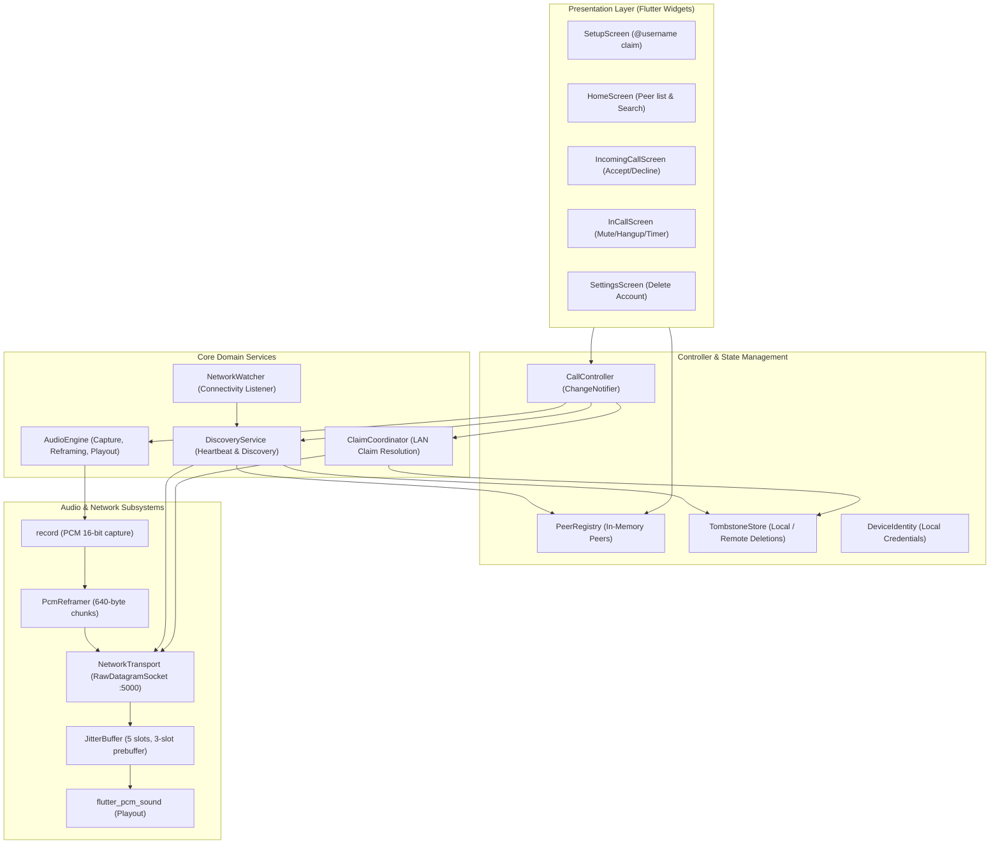
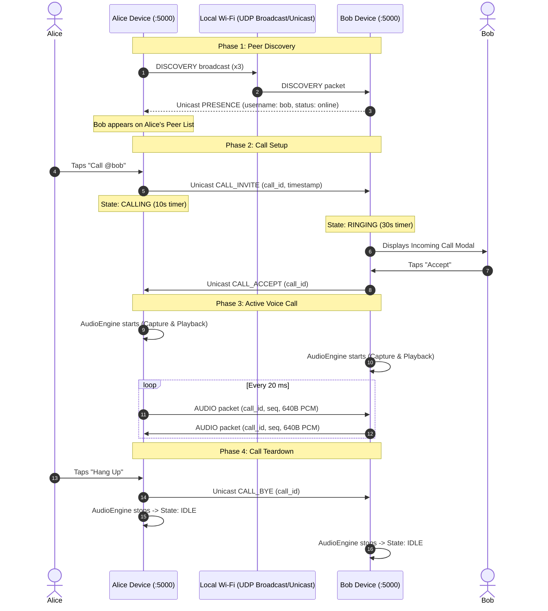

# Minimum Viable Product (MVP) Specification — LAN Voice Call App

**Version:** 1.0  
**Status:** Approved
**Last updated:** Oct 19, 2026  
**Owner:** jakegithub24  
**Companion docs:** PRD.md, TRD.md, SystemDesign.md, wbs.md

---

## 1. Executive Summary & Value Proposition

The **CallMan LAN Voice Call App** is a lightweight, decentralized Flutter application enabling **real-time 1-to-1 voice calls exclusively over a local Wi-Fi network**.

It requires:
- **Zero server infrastructure** (no backend, no cloud, no database).
- **Zero external accounts** (no phone number, email, or passwords).
- **Zero internet connectivity** (the local subnet is the entire communication universe).

The MVP delivers end-to-end functionality allowing any two devices on the same Wi-Fi router to automatically discover each other via UDP broadcast, display presence, establish two-way raw PCM audio streaming with low latency (< 200 ms), and gracefully manage decentralized identities and account deletions.

---

## 2. Core Invariants & Operating Boundaries

1. **Symmetric Peer Architecture:** Every device executes identical software; roles (caller/callee, inviter/invitee) exist only dynamically per call session.
2. **Foreground-Only Realtime Operation:** Voice streaming and active listening occur while the app is in the foreground to eliminate OS background socket suspension issues.
3. **Dedicated Port 5000 UDP:** All discovery, presence heartbeats, signaling, and voice payloads travel over UDP port 5000 (with automatic fallback to 5001–5010 if occupied).
4. **Standard Raw Audio Stream:** 16,000 Hz, 16-bit signed LE, mono PCM packaged in 20 ms frames (640 bytes payload). No codecs or complex audio transformation pipelines are used in the MVP.
5. **Decentralized Ephemeral Identity:** Random 32-bit `device_id` paired with a user-selected `@username`, verified across the LAN via cooperative broadcast claims and tombstones.

---

## 3. MVP Scope Definition (P0 Features)

The MVP strictly encompasses features prioritized as **P0** in [PRD.md §3](PRD.md#3-feature-list-prioritized).

| Feature ID | Feature Name | MVP Scope & Technical Implementation |
|---|---|---|
| **F1** | **Device Identity** | Random uint32 `device_id` generated on first run and stored in `shared_preferences`. User chooses an `@username` (3–20 chars, `^[a-z][a-z0-9_]{2,19}$`). Identity survives app reboots. |
| **F2** | **Auto-Discovery** | Automatic detection of active peers within 1 second of opening the app. Sends a burst of 3 `DISCOVERY` packets (200 ms interval) on startup; peers respond immediately with unicast `PRESENCE`. |
| **F3** | **Peer List** | Home screen displays live peers showing `@username`, 8-char hex `device_id`, IP address, and status badge (`Online`, `In Call`, `Offline`). |
| **F4** | **Peer Search** | Real-time case-insensitive filter bar filtering by username substring or device ID hex prefix without external search requests. |
| **F5** | **1-to-1 Voice Call** | Tap an online peer to send `CALL_INVITE`. Peer screen rings with Accept/Decline. On accept, establishes bidirectional raw PCM voice streaming over UDP unicast. |
| **F6** | **Call Controls** | Active call interface with live duration timer (`HH:MM:SS`), microphone mute toggle, and hang-up button triggering `CALL_BYE`. |
| **F7** | **Incoming Call Screen** | Full-screen incoming call modal presenting caller's `@username`, `device_id`, ring tone/haptic trigger, and Accept / Decline buttons with a 30-second ringout timeout. |
| **F8** | **Presence Status** | Background heartbeat broadcasts `PRESENCE` packet every 3 seconds. Peer marked offline if no presence packet received for 10 seconds. In-call status broadcast via flags. |
| **F9** | **Username Claim & Conflict** | First-launch username verification broadcasts a `CLAIM` packet and awaits 1.5 seconds. If a peer replies with `CONFLICT` (existing claim with earlier timestamp or tombstone), user is prompted to pick another handle. |
| **F10** | **Account Deletion** | Settings option to delete identity: ends active call, broadcasts `USER_DELETE` 3 times, records a 30-day tombstone locally and on peers, wipes local identity, and generates a fresh `device_id` upon next registration. Includes crash-resilient `pending_delete` storage. |
| **F11** | **Network Change Handling** | Listens to `connectivity_plus`. On Wi-Fi network disconnection or transition, clears stale peers from registry, resets socket bindings, and triggers rediscovery. Detects AP isolation and displays warning banner. |

---

## 4. Explicitly Out-of-Scope for MVP

The following items are deferred to post-MVP releases (P1 / P2) to ensure rapid delivery and stability:

- **Group Calling:** No 3+ participant conferences or mesh/SFU architectures (v2).
- **Audio Compression Codecs:** No Opus, AAC, or AMR-WB encoding; raw PCM mono 16 kHz is utilized.
- **Acoustic Echo Cancellation (AEC) & DSP:** No software AEC, noise gate, or AGC. Users should use headphones or keep devices separated.
- **Encryption & Authentication:** No DTLS, SRTP, TLS, or public key cryptography. The MVP assumes a trusted local Wi-Fi environment.
- **Internet / NAT Traversal:** No STUN, TURN, ICE, or WebRTC signaling.
- **Background Calling Services:** No VoIP background push notifications (PushKit / CallKit / ConnectionService) or background UDP listeners. Foreground app state required.
- **Persistent Call History & Contacts:** No call logs or favorited peers persisted to disk (P1).
- **Media / Video / Messaging:** Strictly 1-to-1 audio. No text chat, images, or video streaming.

---

## 5. System Architecture Blueprint

---

## 6. End-to-End User Experience & Flow

### 6.1 First Launch & Onboarding
1. User opens CallMan for the first time.
2. System requests Local Network permission (iOS) and Microphone / Wi-Fi multicast permissions (Android).
3. Setup screen asks user to choose `@username`.
4. App executes LAN query (`CLAIM` broadcast).
5. If no conflict within 1.5 seconds, identity is stored in `shared_preferences` and user transitions to `HomeScreen`.

### 6.2 Peer Discovery & Calling

---

## 7. Technical Specifications & Constants

| Category | Parameter | MVP Value |
|---|---|---|
| **Audio Format** | Sample Rate | 16,000 Hz |
| | Channels | 1 (Mono) |
| | Bit Depth | 16-bit signed PCM (Little-Endian) |
| | Frame Duration | 20 ms |
| | Samples per Frame | 320 samples |
| | Frame Size | 640 bytes |
| **Networking** | Transport Protocol | UDP (`RawDatagramSocket`) |
| | Default Port | 5000 (bind 0.0.0.0, fallback up to 5010) |
| | Max Packet Size | ≤ 1500 bytes (MTU compliant) |
| | Protocol Version | `0x01` |
| **Jitter Buffer** | Capacity | 5 frames (100 ms) |
| | Prebuffer Fill Threshold | 3 frames (60 ms) before playout starts |
| | Concealment | 640-byte silence frame injection on loss |
| **Timing Intervals** | Presence Heartbeat | 3.0 seconds |
| | Offline Timeout | 10.0 seconds (3 missed heartbeats) |
| | Discovery Burst | 3 packets spaced 200 ms apart |
| | Username Claim Wait | 1.5 seconds |
| | Call Invite Timeout | 10.0 seconds |
| | Ringout Timeout | 30.0 seconds |
| | Audio Loss Timeout | 2.0 seconds (triggers call drop) |
| **Tombstones** | Auto-Tombstone Inactivity | 7 days of silence |
| | Tombstone Expiry | 30 days retention |
| | Max Tombstone Entries | 100 entries (LRU pruned) |

---

## 8. Definition of Done (DoD) for MVP

A feature or milestone is considered complete for the MVP only when:

1. **Protocol Compliance:** Packets strictly match binary specifications outlined in [SystemDesign.md §4](SystemDesign.md#4-protocol-specification).
2. **Quality Gates Passed:**
   - Zero errors reported by `flutter analyze`.
   - All unit tests for packet serialization, reframing, and jitter buffer pass (`flutter test`).
3. **Cross-Platform Verification:**
   - Runs cleanly on Android (API 26+) and iOS (14.0+).
   - Real hardware two-device testing demonstrates bidirectional, intelligible voice communication.
4. **Latency & Performance Targets:**
   - End-to-end voice latency measured at < 200 ms on a standard home Wi-Fi network.
   - Discovery populates within 1 second of opening the app.
   - CPU utilization remains < 15% and memory footprint < 40 MB during an active call.
5. **Resilience & Clean Teardown:**
   - Call reliably terminates upon network drop or remote app closure within 2 seconds.
   - Account deletion completely purges local credentials and propagates tombstone to active peers.

---

## 9. MVP Milestones & Release Path

- **Milestone 1 (M1): UDP Transport & Broadcast Discovery:** Sockets bind, two devices discover each other, and exchange presence.
- **Milestone 2 (M2): Peer Management & UI Dashboard:** HomeScreen peer list, search filtering, and online/offline status updates.
- **Milestone 3 (M3): End-to-End Call Signaling & Audio Pipeline:** Ringing, call setup, audio capture/playback, and jitter buffer operational.
- **Milestone 4 (M4): Identity Claims & Account Deletion:** First-run username claim protocol, conflict detection, and tombstone deletion flow.
- **Milestone 5 (M5): Network Edge Cases & Resilience:** Wi-Fi disconnect/reconnect handling, AP isolation detection, and socket failover.
- **Milestone 6 (M6): Verification, Profiling & Hardening:** End-to-end real device testing, performance tuning, and release build sign-off.
