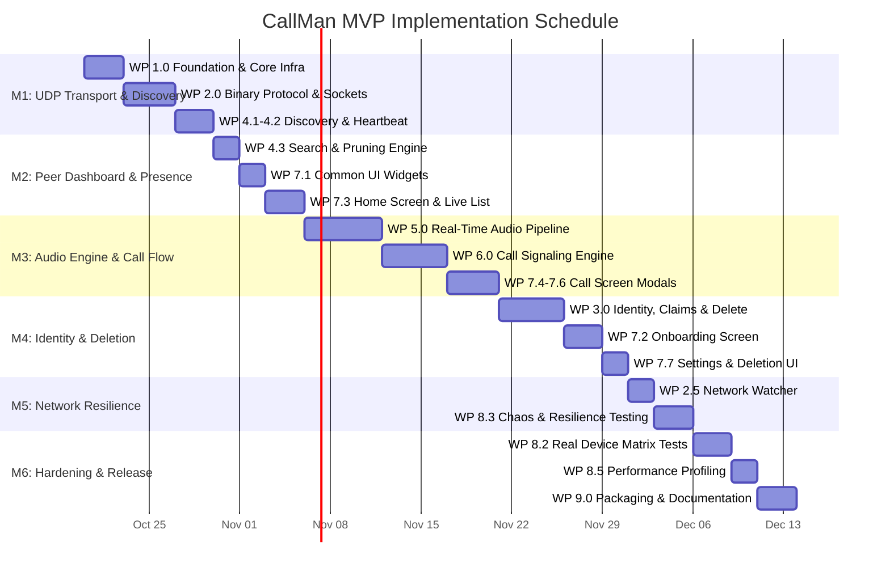
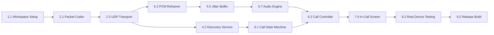

# Work Breakdown Structure (WBS) — LAN Voice Call App (CallMan)

**Version:** 1.0  
**Status:** Approved
**Last updated:** Oct 19, 2026  
**Owner:** jakegithub24  
**Companion docs:** PRD.md, TRD.md, SystemDesign.md, MVP.md

---

## 1. Executive Summary & Purpose

This **Work Breakdown Structure (WBS)** decomposes the entire engineering lifecycle for delivering the **CallMan Minimum Viable Product (MVP)**. It organizes work into hierarchical packages, defining explicit tasks, dependencies, estimations, deliverables, and acceptance criteria.

The WBS is structured into **9 Top-Level Work Packages (1.0 – 9.0)** aligned with the 16 implementation steps outlined in SystemDesign.md §13 and the 6 Project Milestones defined in PRD.md.

---

## 2. WBS Structure Overview

```text
1.0 Project Foundation & Core Infrastructure
    ├── 1.1 Flutter Environment & Workspace Setup
    ├── 1.2 Platform Permissions & Manifest Configuration
    ├── 1.3 Core Constants & Utility Framework
    └── 1.4 State Management & Service Architecture

2.0 Binary Protocol & Network Transport Layer
    ├── 2.1 Packet Specification & Binary Serialization
    ├── 2.2 Packet Codec Unit Test Suite
    ├── 2.3 UDP NetworkTransport Implementation
    ├── 2.4 Transport Broadcast Echo Verification
    └── 2.5 Network Watcher & Connectivity Monitor

3.0 Identity, Claim Protocol & Deletion Engine
    ├── 3.1 Device Identity & Persistent Storage
    ├── 3.2 Username Validation Engine
    ├── 3.3 Tombstone Store & Lifecycle Manager
    ├── 3.4 LAN Claim Coordinator & Conflict Arbiter
    ├── 3.5 Account Deletion & Crash Recovery Flow
    └── 3.6 Identity & Tombstone Unit Tests

4.0 Peer Discovery & Presence Subsystem
    ├── 4.1 Peer Model & PeerRegistry
    ├── 4.2 DiscoveryService Engine
    ├── 4.3 Search & Filtering Subsystem
    └── 4.4 Discovery & Presence Test Suite

5.0 Real-Time Audio Pipeline
    ├── 5.1 Microphone Capture & Streaming (`record`)
    ├── 5.2 PCM Audio Reframer (640-byte / 20ms slicing)
    ├── 5.3 Audio Packet Sender (Sequencing & Packaging)
    ├── 5.4 Audio Packet Receiver & Sequence Tracking
    ├── 5.5 Jitter Buffer & Concealment Engine
    ├── 5.6 Low-Latency PCM Playback (`flutter_pcm_sound`)
    ├── 5.7 AudioEngine Orchestration & Watchdog
    └── 5.8 Audio Pipeline Test Suite

6.0 Call Signaling & Orchestration (CallController)
    ├── 6.1 Call State Machine & Call ID Generator
    ├── 6.2 Outgoing Call Signaling Flow
    ├── 6.3 Incoming Call Signaling Flow
    ├── 6.4 Call Teardown & BYE Flow
    ├── 6.5 Call Watchdogs & Failure Recovery
    └── 6.6 Signaling & State Machine Test Suite

7.0 User Interface & Presentation Layer
    ├── 7.1 Reusable UI Component Library
    ├── 7.2 Setup & Identity Onboarding Screen
    ├── 7.3 Home Screen & Live Peer List
    ├── 7.4 Outgoing Call Screen
    ├── 7.5 Incoming Call Screen Modal
    ├── 7.6 In-Call Active Session Screen
    ├── 7.7 Settings & Account Deletion Screen
    └── 7.8 UI & Widget Test Suite

8.0 Quality Assurance, Resilience & Performance
    ├── 8.1 End-to-End Mock UDP Loopback Suite
    ├── 8.2 Real-Device LAN Multi-Platform Matrix Testing
    ├── 8.3 Network Chaos & Resilience Testing
    ├── 8.4 Lifecycle & Crash-Safety Verification
    └── 8.5 Performance Profiling & Latency Benchmarks

9.0 Packaging, Release Engineering & Documentation
    ├── 9.1 Build Flavors & CI/CD Pipeline
    ├── 9.2 Release Artifact Generation (Android APK / iOS)
    └── 9.3 Documentation & Deployment Runbooks
```

---

## 3. Detailed Work Breakdown Packages

### WP 1.0: Project Foundation & Core Infrastructure
**Objective:** Establish the Flutter workspace, code quality standards, platform permissions, and architectural boilerplate.

| Task ID | Task Name | Description & Deliverables | Dependencies | Effort | Acceptance Criteria |
|---|---|---|---|---|---|
| **1.1.1** | Flutter Workspace Initialization | Create Flutter project targeting iOS & Android (`flutter create --org com.callman callman`). Configure `.gitignore`, `analysis_options.yaml` (with strict lints), and directory hierarchy according to [SystemDesign.md §12](file:///home/champ/Storage/Github/Repositories/CallMan/Artifacts/SystemDesign.md#L709-L764). | None | 2h | `flutter doctor` clean; `analysis_options.yaml` enforces pedantic linter rules. |
| **1.1.2** | Dependency Management | Add core packages to `pubspec.yaml`: `provider` (^6.1.0), `shared_preferences` (^2.2.0), `record` (^5.1.0), `flutter_pcm_sound` (^3.0.0), `connectivity_plus` (^5.0.0), `permission_handler` (^11.0.0). | 1.1.1 | 1h | `flutter pub get` resolves with zero conflicts. |
| **1.2.1** | iOS Configuration & Permissions | Configure `ios/Runner/Info.plist` with `NSLocalNetworkUsageDescription` and `NSMicrophoneUsageDescription`. Verify Bonjour keys if needed. | 1.1.1 | 2h | Permission prompts present accurate descriptive text on iOS 14+. |
| **1.2.2** | Android Configuration & Permissions | Update `AndroidManifest.xml` with `RECORD_AUDIO`, `INTERNET`, `ACCESS_NETWORK_STATE`, `ACCESS_WIFI_STATE`, and `CHANGE_WIFI_MULTICAST_STATE`. Configure target SDK 34, min SDK 26. | 1.1.1 | 2h | Multicast lock acquisition and audio record permissions compile cleanly. |
| **1.3.1** | Core Constants Module | Implement `lib/core/constants.dart` defining all protocol types, network ports (5000, 5001–5010), timings, audio constants, and buffer capacities per [SystemDesign.md §11](file:///home/champ/Storage/Github/Repositories/CallMan/Artifacts/SystemDesign.md#L640-L704). | 1.1.1 | 2h | All magic numbers centralized; strictly immutable `const` declarations. |
| **1.3.2** | Logging & Error Handling | Implement `lib/core/logging.dart` and `lib/core/app_error.dart` with strongly-typed error variants for network, audio, identity, and permissions. | 1.3.1 | 2h | Typed exceptions and clean console logging without leaking PII. |
| **1.4.1** | State Architecture & DI Boilerplate | Setup root `MultiProvider` in `lib/app.dart` providing stubs for `CallController`, `PeerRegistry`, `DeviceIdentity`, and `TombstoneStore`. | 1.1.2, 1.3.2 | 2h | App boots cleanly to empty placeholder screen. |

---

### WP 2.0: Binary Protocol & Network Transport Layer
**Objective:** Implement raw UDP socket transport and high-speed binary codecs for all 11 protocol packets.

| Task ID | Task Name | Description & Deliverables | Dependencies | Effort | Acceptance Criteria |
|---|---|---|---|---|---|
| **2.1.1** | Packet Data Models | Create `lib/network/packet_types.dart` containing sealed class hierarchy: `BasePacket`, `PresencePacket`, `DiscoveryPacket`, `CallInvitePacket`, `CallAcceptPacket`, `CallRejectPacket`, `CallByePacket`, `AudioPacket`, `ClaimPacket`, `ConflictPacket`, `UserDeletePacket`. | 1.3.1 | 4h | Complete typed model coverage for all protocol commands. |
| **2.1.2** | Binary Codec Serialization & Parsing | Implement `lib/network/packets.dart` using `ByteData` and `Uint8List` to encode and decode each packet type with exact 2-byte header `[type: 1B][version: 0x01]`. | 2.1.1 | 6h | Packets strictly adhere to binary schema in [SystemDesign.md §4](file:///home/champ/Storage/Github/Repositories/CallMan/Artifacts/SystemDesign.md#L259-L289); invalid packets return `null`. |
| **2.2.1** | Packet Codec Unit Tests | Implement `test/network/packets_test.dart` testing encode/decode roundtrips for every packet type, handling boundary lengths, UTF-8 usernames, and invalid formats. | 2.1.2 | 4h | 100% test pass; code coverage > 95% on codec logic. |
| **2.3.1** | UDP NetworkTransport Socket Layer | Implement `lib/network/network_transport.dart` with `RawDatagramSocket.bind(InternetAddress.anyIPv4, 5000)`. Add port retry fallback (5001–5010), broadcast enabling (`socket.broadcastEnabled = true`), and stream emission of `IncomingPacket`. | 1.3.1, 2.1.2 | 5h | Socket binds on 0.0.0.0:5000; non-blocking read emits parsed `IncomingPacket` stream; drops malformed packets. |
| **2.3.2** | Unicast & Broadcast Dispatchers | Implement `send(bytes, dest, port)` and `broadcast(bytes, port)` in `NetworkTransport` with subnet broadcast target `255.255.255.255`. | 2.3.1 | 2h | Verifiable packet transmission across network interface. |
| **2.4.1** | Broadcast Echo Smoke Test | Create integration smoke test script or lightweight test harness verifying two nodes on same subnet exchange ping/pong packets via `NetworkTransport`. | 2.3.2 | 3h | Milestone Step 1 validation: two physical devices receive each other's echo packets. |
| **2.5.1** | Network Watcher Service | Implement `lib/network/network_watcher.dart` using `connectivity_plus` and `NetworkInterface.list()` to detect active Wi-Fi IP, subnet changes, and link drops. | 1.3.2, 2.3.1 | 4h | Emits events on Wi-Fi connect, disconnect, and IP change. |

---

### WP 3.0: Identity, Claim Protocol & Deletion Engine
**Objective:** Implement decentralized identity generation, LAN username claim resolution, tombstone tracking, and crash-safe account deletion.

| Task ID | Task Name | Description & Deliverables | Dependencies | Effort | Acceptance Criteria |
|---|---|---|---|---|---|
| **3.1.1** | Device Identity & Local Storage | Implement `lib/identity/device_identity.dart`. Generate random uint32 `device_id` via `Random.secure()`, persist to `shared_preferences`, and handle username / claim timestamp storage. | 1.3.1, 1.1.2 | 3h | Device ID generated once and preserved across app restarts. |
| **3.1.2** | Username Format Validation | Implement `lib/identity/username_validator.dart` validating length (3–20 chars), regex `^[a-z][a-z0-9_]{2,19}$`, and reserved names check (`me`, `all`, `system`, `admin`). | 1.3.1 | 2h | Validates compliant handles; rejects illegal characters or reserved words. |
| **3.2.1** | Tombstone Store Implementation | Implement `lib/discovery/tombstone_store.dart`. Store deleted `{deviceId, username, deletedAt, expiresAt}` in `shared_preferences` JSON array (max 100 entries). | 1.3.1, 3.1.1 | 4h | Prunes tombstones older than 30 days; persists deletions across app launches. |
| **3.2.2** | Auto-Tombstone & Stale Pruning | Implement logic in `TombstoneStore` to auto-tombstone ungracefully deleted peers after 7 days of silence. | 3.2.1 | 2h | Auto-converts inactive peers to tombstones after 7 days. |
| **3.3.1** | LAN Username Claim Coordinator | Implement `lib/identity/claim_coordinator.dart`. Broadcast `CLAIM` packet; wait 1.5s for `CONFLICT` replies. If conflicting claim exists, resolve via timestamp seniority (`claimed_at`). | 2.3.2, 3.1.2, 3.2.1 | 5h | Successfully claims unique handle; detects LAN conflicts within 1.5s window. |
| **3.4.1** | Account Deletion Orchestration | Implement graceful account deletion: terminate active call, write `pending_delete` to storage, broadcast `USER_DELETE` 3x (200 ms interval), add local tombstone, purge local identity, and generate new `device_id`. | 2.3.2, 3.1.1, 3.2.1 | 4h | Peer vanishes from LAN within 100 ms; username immediately freed for re-claim. |
| **3.4.2** | Crash-Safe Pending Delete Recovery | In `main.dart` / `DeviceIdentity`, check for `pending_delete` during initialization; rebroadcast `USER_DELETE` if interrupted by crash, then purge state. | 3.4.1 | 3h | Interrupted deletion automatically completes on subsequent app launch. |
| **3.5.1** | Identity & Tombstone Unit Tests | Create `test/identity/identity_test.dart` and `test/discovery/tombstone_test.dart` testing validation, claim conflict resolution, and tombstone expiry rules. | 3.3.1, 3.4.2 | 4h | 100% test pass on identity and deletion logic. |

---

### WP 4.0: Peer Discovery & Presence Subsystem
**Objective:** Maintain an in-memory real-time registry of all active peers on the LAN via heartbeat broadcasts.

| Task ID | Task Name | Description & Deliverables | Dependencies | Effort | Acceptance Criteria |
|---|---|---|---|---|---|
| **4.1.1** | Peer Model & Status Computation | Implement `lib/discovery/peer.dart` tracking `deviceId`, `username`, `ipAddress`, `lastSeen`, `inCall`, `claimedAt`. Provide computed properties `deviceIdHex` and `PeerStatus` (`online`, `inCall`, `offline`). | 1.3.1 | 2h | Accurately calculates status based on heartbeat freshness. |
| **4.1.2** | PeerRegistry State Manager | Implement `lib/discovery/peer_registry.dart` (`ChangeNotifier`). Maintain in-memory map of peers; implement `upsert`, `remove`, `clearOnlinePeers`, and periodic `pruneStale`. Check each update against `TombstoneStore`. | 3.2.1, 4.1.1 | 4h | Notifies listeners on peer changes; ignores tombstoned device IDs. |
| **4.2.1** | Discovery Engine & Burst Sender | Implement `lib/discovery/discovery_service.dart`. On start, broadcast burst of 3 `DISCOVERY` packets spaced 200 ms apart; handle incoming `DISCOVERY` by sending unicast `PRESENCE` response to sender. | 2.3.2, 4.1.2 | 4h | Immediate discovery of LAN peers upon launch (< 500 ms). |
| **4.2.2** | Heartbeat Periodic Broadcaster | Setup periodic 3.0s timer in `DiscoveryService` broadcasting `PRESENCE` packet containing current `deviceId`, `username`, status flags (in-call), and active call ID. | 4.2.1 | 3h | Consistent 3s broadcast cadence with accurate flags. |
| **4.2.3** | Presence Inactivity Watchdog | In `PeerRegistry`, run periodic sweep marking peers offline after 10 seconds (3 missed heartbeats) without `PRESENCE`. | 4.1.2, 4.2.2 | 2h | Peers transition to offline state after 10s of network silence. |
| **4.3.1** | Peer Search & Filtering Engine | Implement `search(String query)` in `PeerRegistry` performing case-insensitive matching against `@username` substring and `device_id` hex prefix. | 4.1.2 | 2h | Real-time filtering (< 10 ms execution) for lists up to 100 peers. |
| **4.4.1** | Discovery Subsystem Unit Tests | Implement `test/discovery/discovery_service_test.dart` using mock transport to verify discovery bursts, presence responses, and 10s offline timeout. | 4.2.3, 4.3.1 | 4h | All discovery state transitions verified under test runner. |

---

### WP 5.0: Real-Time Audio Pipeline
**Objective:** Deliver low-latency bidirectional PCM audio capture, packet reframing, UDP dispatch, jitter buffering, and playout.

| Task ID | Task Name | Description & Deliverables | Dependencies | Effort | Acceptance Criteria |
|---|---|---|---|---|---|
| **5.1.1** | Microphone Capture Engine | Implement `lib/audio/audio_capture.dart` using `record` package configured for `AudioEncoder.pcm16bits`, 16,000 Hz, mono. Stream raw chunks via `record.startStream()`. | 1.1.2, 1.2.1, 1.2.2 | 4h | Emits continuous stream of raw PCM 16-bit audio bytes. |
| **5.2.1** | PCM Chunk Reframer | Implement `lib/audio/pcm_reframer.dart` with internal buffer accumulating variable-sized input chunks and emitting exact 640-byte (20 ms / 320 samples) frames. | 1.3.1, 5.1.1 | 4h | Emits strictly 640-byte chunks at 50 packets/second cadence without sample leaks. |
| **5.3.1** | Audio Packet Sender | Implement `lib/audio/audio_sender.dart`. Prepend 8-byte `call_id` and 2-byte sequence number (`seq`, 0–65535 with wrap-around) to 640B PCM payload; dispatch via `NetworkTransport.send()`. | 2.3.2, 5.2.1 | 3h | Valid `AudioPacket` frames dispatched via UDP unicast to peer IP. |
| **5.4.1** | Audio Packet Receiver | Implement `lib/audio/audio_receiver.dart`. Filter incoming packets by `call_id`; discard stale/duplicate packets; forward valid frames to JitterBuffer. | 2.3.1, 5.3.1 | 3h | Drops packets with mismatched `call_id` or sequence older than window threshold. |
| **5.5.1** | Jitter Buffer Architecture | Implement `lib/audio/jitter_buffer.dart` with 5-slot ring buffer. Enforce 3-slot (60 ms) prebuffer threshold before triggering playout. | 1.3.1, 5.4.1 | 6h | Smooths out network arrival jitter; handles packet reordering. |
| **5.5.2** | Playout Clock & Loss Concealment | Implement 20 ms periodic timer in `JitterBuffer` popping the next expected frame. If slot is missing, emit 640 bytes of silence (`Uint8List(640)`) to maintain playout cadence. | 5.5.1 | 4h | Strictly ticks every 20 ms; prevents audio clicks or buffer underflow stutter. |
| **5.6.1** | Low-Latency PCM Playout | Implement `lib/audio/audio_playback.dart` wrapping `flutter_pcm_sound` configured for 16 kHz mono. Feed frames directly to audio output stream. | 1.1.2, 5.5.2 | 4h | Clean audio output without underrun stutter or buffer backlog exceeding 100 ms. |
| **5.7.1** | AudioEngine Master Controller | Implement `lib/audio/audio_engine.dart` orchestrating capture, reframer, sender, receiver, jitter buffer, and playback. Include `setMuted(bool)` and 2.0s silence watchdog. | 5.1.1, 5.6.1 | 5h | Single `start()` / `stop()` call controls entire audio lifecycle; detects 2s audio loss. |
| **5.8.1** | Audio Reframer & Jitter Unit Tests | Implement `test/audio/pcm_reframer_test.dart` and `test/audio/jitter_buffer_test.dart` testing variable chunk slicing, packet reordering, and silence injection. | 5.2.1, 5.5.2 | 5h | 100% pass on reframer slicing and jitter buffer packet sequence logic. |

---

### WP 6.0: Call Signaling & Orchestration (CallController)
**Objective:** Implement the central call state machine, orchestrating signaling, session timers, and audio pipelines.

| Task ID | Task Name | Description & Deliverables | Dependencies | Effort | Acceptance Criteria |
|---|---|---|---|---|---|
| **6.1.1** | Call State Machine Model | Implement `lib/call/call_state.dart` with `CallState` enum (`idle`, `calling`, `ringing`, `in_call`, `ending`) and `lib/call/call_id.dart` generating random 64-bit call IDs. | 1.3.1 | 2h | Clear, immutable state definitions and collision-resistant call IDs. |
| **6.2.1** | CallController Core Orchestrator | Implement `lib/call/call_controller.dart` (`ChangeNotifier`). Inject `NetworkTransport`, `AudioEngine`, `PeerRegistry`, and `DeviceIdentity`. Wire incoming packet dispatching. | 2.3.1, 4.1.2, 5.7.1, 6.1.1 | 5h | Core orchestrator operational; receives filtered signaling stream. |
| **6.3.1** | Outgoing Call Signaling Flow | Implement `startCall(Peer peer)`: transition to `CALLING`, generate `call_id`, dispatch `CALL_INVITE`, start 10s invite timer. Handle `CALL_ACCEPT` (transition to `IN_CALL`, start `AudioEngine`) and `CALL_REJECT` (return to `IDLE`). | 6.2.1 | 4h | Caller transitions to calling; moves to in-call upon peer acceptance or cancels after 10s. |
| **6.4.1** | Incoming Call Signaling Flow | Handle incoming `CALL_INVITE` in `CallController`: if not `IDLE`, send `CALL_REJECT` (reason: busy); if `IDLE`, transition to `RINGING`, start 30s ringout timer. Implement `acceptIncoming()` and `rejectIncoming(reason)`. | 6.2.1 | 4h | Callee transitions to ringing; accept starts audio; reject returns to idle; 30s timeout auto-rejects. |
| **6.5.1** | Call Teardown & BYE Flow | Implement `hangUp()`: dispatch `CALL_BYE` to peer, stop `AudioEngine`, transition to `ENDING`, reset to `IDLE` after 500 ms. Handle received `CALL_BYE` identically. | 6.3.1, 6.4.1 | 3h | Clean teardown from either end; both devices return to `IDLE` within 1s. |
| **6.5.2** | Call Watchdogs & Error Recovery | Implement 2.0s audio loss watchdog in `CallController`: if no audio received for 2s while in `IN_CALL`, trigger teardown with "Connection lost" error banner. | 5.7.1, 6.5.1 | 3h | Call cleanly terminates when remote peer abruptly leaves Wi-Fi. |
| **6.6.1** | Call Signaling Unit Tests | Implement `test/call/call_controller_test.dart` using mock transport to test invite timeout, accept sequence, busy rejection, and hang-up teardown. | 6.5.2 | 5h | All state transitions in [SystemDesign.md §5.1](file:///home/champ/Storage/Github/Repositories/CallMan/Artifacts/SystemDesign.md#L308-L353) thoroughly verified. |

---

### WP 7.0: User Interface & Presentation Layer
**Objective:** Build responsive Flutter screens and widgets reflecting live presence, search, call controls, and settings.

| Task ID | Task Name | Description & Deliverables | Dependencies | Effort | Acceptance Criteria |
|---|---|---|---|---|---|
| **7.1.1** | Common UI Component Library | Implement `lib/widgets/peer_card.dart`, `lib/widgets/status_indicator.dart`, `lib/widgets/search_bar.dart`, and `lib/widgets/call_timer.dart` complying with dark mode and 48dp touch targets. | 1.1.1, 4.1.1 | 4h | Standardized widgets rendering according to accessibility standards. |
| **7.2.1** | Setup & Identity Onboarding Screen | Implement `lib/screens/setup_screen.dart`. Include OS permission rationale dialogs, username text field with real-time format validation, claim progress spinner, and conflict error display. | 3.1.2, 3.3.1 | 5h | Blocks user until valid unique username is claimed; persists identity. |
| **7.3.1** | Home Screen & Live Peer List | Implement `lib/screens/home_screen.dart`. Include header with user handle/ID, search bar, pull-to-refresh discovery trigger, live peer list view, and empty state with AP isolation troubleshooting hint. | 4.1.2, 4.3.1, 7.1.1 | 5h | Renders live peers within 1s of launch; updates automatically as peers connect/disconnect. |
| **7.4.1** | Outgoing Call Screen | Implement `lib/screens/outgoing_call_screen.dart` displaying callee username, device ID, pulsating "Calling..." animation, and "Cancel" button. | 6.3.1, 7.1.1 | 3h | Displays during `CALLING` state; cancel aborts invite cleanly. |
| **7.5.1** | Incoming Call Modal Screen | Implement `lib/screens/incoming_call_screen.dart`. Full-screen alert showing caller identity, audio ringing / vibration feedback, and "Accept" / "Decline" action buttons. | 6.4.1, 7.1.1 | 4h | Displays over any screen during `RINGING` state; triggers accept/reject. |
| **7.6.1** | In-Call Active Session Screen | Implement `lib/screens/in_call_screen.dart`. Show active peer details, live duration timer (`HH:MM:SS`), microphone mute toggle, and red "Hang Up" button. | 5.7.1, 6.5.1, 7.1.1 | 4h | Displays during `IN_CALL` state; controls mute and call teardown. |
| **7.7.1** | Settings & Account Deletion Screen | Implement `lib/screens/settings_screen.dart`. Show current `@username`, hex `device_id`, app version, and red "Delete Account" button with confirmation dialog. | 3.4.1, 7.1.1 | 3h | Confirms deletion; triggers full identity wipe and returns to setup screen. |
| **7.8.1** | Screen Widget Tests | Implement widget tests for `HomeScreen`, `SetupScreen`, and `InCallScreen` in `test/screens/`. | 7.3.1, 7.6.1 | 4h | UI components render correctly across various simulated state streams. |

---

### WP 8.0: Quality Assurance, Resilience & Performance
**Objective:** Validate system performance, resilience against network faults, and end-to-end audio quality across physical hardware.

| Task ID | Task Name | Description & Deliverables | Dependencies | Effort | Acceptance Criteria |
|---|---|---|---|---|---|
| **8.1.1** | End-to-End Mock Loopback Test | Implement comprehensive integration test running two `CallController` instances in memory, communicating via looped mock UDP sockets without hardware. | 6.6.1 | 4h | Validates complete invite → accept → audio exchange → bye lifecycle. |
| **8.2.1** | Real-Device Multi-Platform Testing | Execute test matrix on physical hardware: Android to Android, iOS to iOS, Android to iOS on standard 802.11n/ac Wi-Fi router. | 7.6.1 | 6h | Bidirectional speech clearly audible; discovery connects in < 1s. |
| **8.3.1** | Network Chaos & Resilience Testing | Test with `tc netem` or packet loss simulation (1% to 5% loss, 20 ms jitter). Verify jitter buffer concealment and connection loss detection. | 5.7.1, 8.2.1 | 4h | Jitter buffer conceals dropped packets without desync; audio loss drops after 2s. |
| **8.3.2** | Wi-Fi Roaming & Reconnect Testing | Toggle Wi-Fi off and on during idle and active call states. Verify `NetworkWatcher` triggers peer flush and socket rebinding. | 2.5.1, 7.3.1 | 3h | Peer list refreshes within 3s of Wi-Fi reconnect; active call ends gracefully. |
| **8.4.1** | Process Lifecycle & Crash Recovery Testing | Kill app process mid-call and mid-deletion. Verify remote side detects loss within 2s; verify `pending_delete` retries on next app start. | 3.4.2, 6.5.2 | 4h | No orphan state; tombstone broadcast guaranteed on subsequent startup. |
| **8.5.1** | Performance Profiling & Benchmarks | Profile app on physical Android and iOS devices using DevTools. Measure end-to-end audio latency (< 200 ms), CPU (< 10%), and memory (< 30 MB). | 8.2.1 | 4h | Meets all non-functional requirements in [PRD.md §5.1](file:///home/champ/Storage/Github/Repositories/CallMan/Artifacts/PRD.md#L194-L206). |

---

### WP 9.0: Packaging, Release Engineering & Documentation
**Objective:** Configure automated build pipelines, produce signed release binaries, and deliver complete operational documentation.

| Task ID | Task Name | Description & Deliverables | Dependencies | Effort | Acceptance Criteria |
|---|---|---|---|---|---|
| **9.1.1** | CI Workflow Automation | Create `.github/workflows/ci.yml` running `flutter analyze` and `flutter test` on all pull requests. | 1.1.1, 2.2.1 | 3h | CI automatically validates PR builds and runs unit tests. |
| **9.2.1** | Release Build Configuration | Configure release signing keys for Android and iOS. Enable ABI splitting (`flutter build apk --split-per-abi`) to optimize bundle size. | 1.2.1, 1.2.2 | 3h | Generated release APK size < 25 MB; iOS release archive < 50 MB. |
| **9.3.1** | Operational Documentation & Runbooks | Update `README.md` and create troubleshooting guides covering AP isolation workarounds, port conflicts, and permission recovery. | All WP | 3h | Complete documentation with clear setup and usage instructions. |

---

## 4. Milestone Schedule & Deliverable Mapping



| Milestone | Target Deliverable | WBS Packages Mapped | Verification Gate |
|---|---|---|---|
| **M1: Transport & Discovery** | Two devices discover each other over UDP and exchange presence. | 1.1, 1.2, 1.3, 2.1, 2.2, 2.3, 2.4, 4.1, 4.2 | Smoke test confirms two phones log mutual discovery on LAN within 1s. |
| **M2: Peer List & Presence** | Real-time home screen with live presence and instant search. | 4.3, 4.4, 7.1, 7.3 | Peer list displays peers, updates presence status within 3s, and filters instantly. |
| **M3: End-to-End Voice Calling** | Outgoing/incoming call signaling and bidirectional 16 kHz voice streaming. | 5.1, 5.2, 5.3, 5.4, 5.5, 5.6, 5.7, 5.8, 6.1, 6.2, 6.3, 6.4, 6.5, 6.6, 7.4, 7.5, 7.6 | Two physical phones establish call, stream clear voice with < 200 ms latency, and hang up. |
| **M4: Identity Claims & Deletion** | Decentralized username claiming and crash-safe account deletion. | 3.1, 3.2, 3.3, 3.4, 3.5, 7.2, 7.7 | Username conflict detected; account deletion propagates tombstone and clears identity. |
| **M5: Network Resilience** | Network change recovery, Wi-Fi reconnection, and audio loss watchdog. | 2.5, 6.5.2, 8.3.1, 8.3.2 | Wi-Fi toggle clears stale peers and rediscovers; loss of audio ends call within 2s. |
| **M6: Release Sign-Off** | Validated release binaries, passing CI suite, complete user documentation. | 8.1, 8.2, 8.4, 8.5, 9.1, 9.2, 9.3 | Profiler confirms < 10% CPU and < 30 MB RAM; test suite 100% green; release APK built. |

---

## 5. Critical Path & Dependency Matrix

The critical path for CallMan MVP follows the core audio-signaling conduit:



### Critical Path Bottlenecks & Mitigations
1. **Audio Playout Stutter (`flutter_pcm_sound`):**
   - *Risk:* Platform audio buffer underruns causing clicks or high latency.
   - *Mitigation:* Isolate the JitterBuffer with a strict 3-slot prebuffer threshold (Task 5.5.1) and implement silence insertion for missing packets before feeding the audio sink.
2. **UDP Packet Loss on Wi-Fi:**
   - *Risk:* Voice packets dropped due to router queue congestion.
   - *Mitigation:* Audio frame sizing locked to 640 bytes (well below 1500-byte MTU); sequence-based jitter buffer handles packet reordering without retransmission overhead.
3. **OS Multicast & Broadcast Filtering:**
   - *Risk:* Android OEM battery optimizations dropping broadcast discovery packets.
   - *Mitigation:* Acquire `CHANGE_WIFI_MULTICAST_STATE` lock on Android; execute 3x rapid discovery burst on app foregrounding.

---

## 6. Effort Estimation Summary

| Work Package | Total Tasks | Total Estimated Hours | Target Milestone |
|---|---|---|---|
| **WP 1.0 Project Foundation** | 7 | 13 h | M1 |
| **WP 2.0 Binary Protocol & Transport** | 7 | 26 h | M1, M5 |
| **WP 3.0 Identity & Deletion Engine** | 7 | 23 h | M4 |
| **WP 4.0 Discovery & Presence** | 6 | 17 h | M1, M2 |
| **WP 5.0 Real-Time Audio Pipeline** | 8 | 35 h | M3 |
| **WP 6.0 Call Signaling & Orchestration** | 6 | 23 h | M3 |
| **WP 7.0 UI & Presentation Layer** | 8 | 32 h | M2, M3, M4 |
| **WP 8.0 Quality Assurance & Benchmarks** | 5 | 22 h | M5, M6 |
| **WP 9.0 Packaging & Documentation** | 3 | 9 h | M6 |
| **Total** | **57 Tasks** | **200 Hours** | **~5 Weeks (at 40h/week)** |
